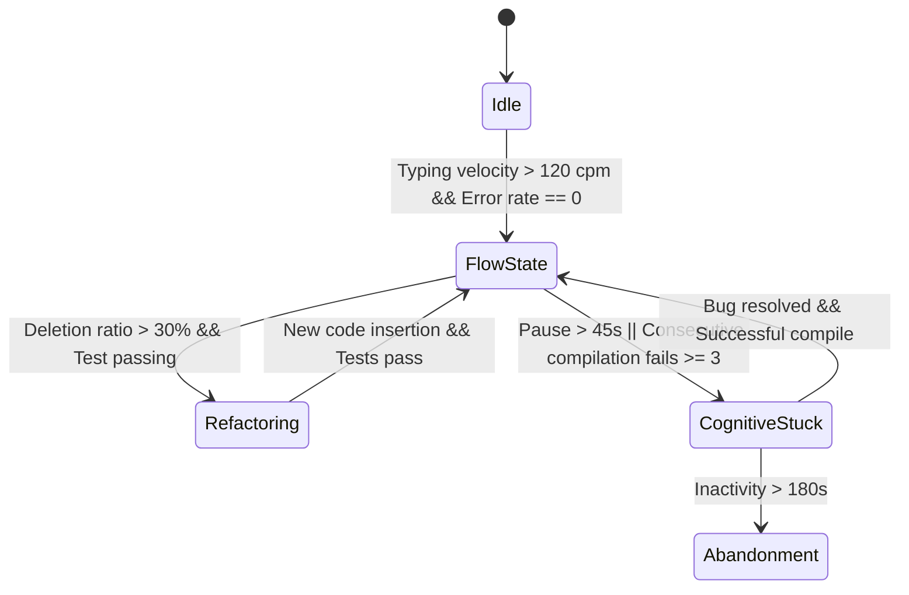
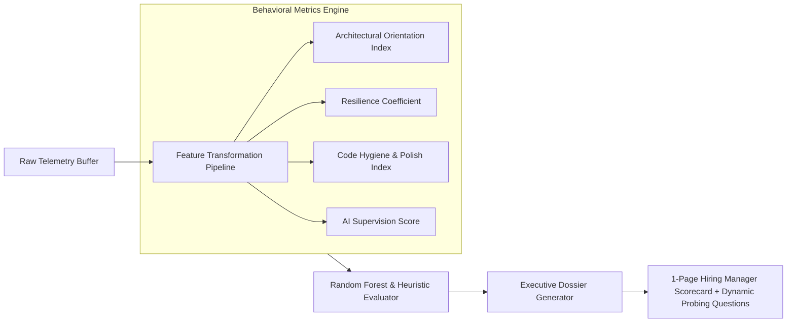

# DEV-TRACE Enterprise Architecture & Algorithmic Blueprint

This blueprint defines the architecture, data schemas, and mathematical algorithms for the three next-generation enterprise evaluation systems:

1. **AI-Supervision Benchmark** (*Evaluating AI Code Auditing & Hallucination Trap Detection*)
2. **Interactive Flight Recorder & Cognitive Heatmap** (*Vector-Based Code Playback & Cognitive State Machine*)
3. **Automated Executive Behavioral Dossier** (*Multi-Metric Engineering Fingerprint & Targeted Interview Prober*)

---

## 1. AI-Supervision Benchmark System

```mermaid
flowchart TD
    Candidate([Candidate in IDE]) -->|Invokes Copilot / Assistant| PromptGateway[Prompt & Context Gateway]
    PromptGateway --> TrapInjector[Trap Injection Engine]
    
    subgraph TrapEngineering ["Trap Injection Pipeline"]
        TrapInjector -->|Pattern A: Security| SQLi[SQL Injection / Sanitization Trap]
        TrapInjector -->|Pattern B: Correctness| OffByOne[Off-By-One / Boundary Edge Case]
        TrapInjector -->|Pattern C: Complexity| ExpTime[O(N²) Quadratic Memory / Timeout Leak]
    end
    
    TrapEngineering --> ReturnCode[Inject Code with Trap into Editor]
    ReturnCode --> DiffMonitor[Telemetry Diff & Mutation Monitor]
    
    subgraph TelemetryAnalysis ["Real-Time Audit Evaluator"]
        DiffMonitor --> CalcMutation[Calculate Mutation Distance M_mut]
        DiffMonitor --> CalcInspection[Calculate Dwell & Review Time T_review]
        DiffMonitor --> TestExecWatcher[Track Targeted Test Executions E_test]
    end
    
    TelemetryAnalysis --> Classifier[Audit Classification Engine]
    Classifier -->|M_mut ~ 0, No Tests| AICarried["🔴 AI-Carried (Plagiarism / Blind Trust)"]
    Classifier -->|M_mut > threshold, Trap Fixed| AISupervised["🟢 AI-Supervised (Senior Architect)"]
    Classifier -->|Zero Copilot Usage| Autonomous["🔵 Pure Autonomous"]
```

### 1.1 Objective & Rationale
Traditional platforms attempt to ban or block AI, which is counterproductive in modern software engineering. The **AI-Supervision Benchmark** measures whether an engineer uses AI like a **Senior Architect** (auditing, verifying, stress-testing) or like a **Novice** (blindly accepting hallucinated or insecure code).

### 1.2 Mathematical Formulation & Scoring Algorithm

#### A. Metric Definitions
Let an AI generation event $i$ produce code string $S_{\text{gen}}^{(i)}$ injected at timestamp $t_{\text{inject}}^{(i)}$.

1. **Review Dwell Ratio ($R_{\text{dwell}}$)**:
   Measures time spent reviewing the code before running tests or making further edits:
   $$\Delta t_{\text{review}} = t_{\text{first\_action}} - t_{\text{inject}}$$
   $$R_{\text{dwell}} = \min\left(1.0, \frac{\Delta t_{\text{review}}}{\text{len}(S_{\text{gen}}) \times \tau_{\text{reading}}}\right)$$
   *(where $\tau_{\text{reading}} \approx 25\,\text{ms/char}$ is the human reading speed benchmark).*

2. **Normalized Code Mutation Distance ($M_{\text{mut}}$)**:
   Measures how much the candidate refactored, corrected, or pruned the AI response:
   $$M_{\text{mut}} = \frac{\text{Levenshtein}(S_{\text{gen}}^{(i)}, S_{\text{final}}^{(i)})}{\max(\text{len}(S_{\text{gen}}^{(i)}), \text{len}(S_{\text{final}}^{(i)}))}$$

3. **Trap Neutralization Boolean ($N_{\text{trap}}$)**:
   $$N_{\text{trap}} = \begin{cases} 
   1.0 & \text{if candidate fixed the injected trap (security / edge-case / algorithmic)} \\
   0.0 & \text{if trap was submitted into final test unchanged}
   \end{cases}$$

4. **Targeted Verification Factor ($V_{\text{verify}}$)**:
   Tracks whether the candidate ran sandbox test suites specifically targeting the AI-generated functions within window $\Delta t = 45\text{s}$:
   $$V_{\text{verify}} = \min\left(1.0, \frac{E_{\text{executed\_tests}}}{2}\right)$$

#### B. Composite AI Supervision Score ($S_{\text{AIS}}$)
$$S_{\text{AIS}} = 0.40 \cdot N_{\text{trap}} + 0.25 \cdot M_{\text{mut}} + 0.20 \cdot V_{\text{verify}} + 0.15 \cdot R_{\text{dwell}}$$

#### C. Classification Thresholds
- **AI-Supervised (Senior Auditor)**: $S_{\text{AIS}} \ge 0.70$ and $N_{\text{trap}} = 1.0$
- **AI-Assisted (Normal Usage)**: $0.40 \le S_{\text{AIS}} < 0.70$
- **AI-Carried (Plagiarism / High Risk)**: $S_{\text{AIS}} < 0.40$ (indicates blind pasting of flawed code)

---

## 2. Interactive "Flight Recorder" & Cognitive Heatmap



### 2.1 Storage & Playback Architecture
Rather than storing gigabytes of invasive video recordings, the **Flight Recorder** stores fine-grained vector diffs:
- **Periodic Snapshot Keyframes** every 60 seconds (full document state).
- **Operation Deltas** (cursor offset, character delta, timestamp, file ID).
- Result: An entire 60-minute assessment session compresses into **< 400 KB** of JSON data.

### 2.2 Cognitive State Machine Algorithm

Every second $t$, compute metrics over sliding window $W = [t - 15\text{s}, t]$:
- $K(t)$: Keystrokes per minute.
- $D(t) = \frac{\text{deletions}}{\text{insertions} + \text{deletions}}$: Deletion / Refactor ratio.
- $P(t)$: Inactivity dwell time in seconds.
- $E(t)$: Number of compilation / test failures in the last 60 seconds.

| State | Color Code | Condition | Meaning |
| :--- | :--- | :--- | :--- |
| **Flow State** | 🟢 `#10b981` (Emerald) | $K(t) \ge 100$, $D(t) \le 0.20$, $E(t) = 0$ | Rapid implementation, clear solution in mind |
| **Iterative Refactoring** | 🟡 `#f59e0b` (Amber) | $D(t) \ge 0.35$, $K(t)$ active, restructuring code | Actively polishing and improving architecture |
| **Cognitive Friction** | 🔴 `#ef4444` (Rose) | $P(t) \ge 45\text{s}$ OR $E(t) \ge 3$ consecutive errors | Stuck, debugging loop, or architectural confusion |
| **Idle / Research** | 🟣 `#8b5cf6` (Indigo) | Editor focus lost or README opened $> 20\text{s}$ | Reading documentation or thinking outside code |

### 2.3 Timeline Scrubber Data Structure
```typescript
interface TimelineScrubberSlice {
  timestamp: number; // relative elapsed milliseconds
  state: "FLOW" | "REFACTOR" | "STUCK" | "IDLE";
  activeFile: string;
  cursorLine: number;
  stabilityScore: number;
  testStatus: "PASSING" | "FAILING" | "UNTESTED";
  eventSummary: string; // e.g. "Fixed TypeError in calculate_interest()"
}
```

---

## 3. Automated Executive Behavioral Dossier



### 3.1 Quantitative Engineering Indices

#### 1. Architectural Orientation Index ($AOI$)
Measures whether a candidate plans before coding.
$$AOI = 0.50 \cdot \min\left(1.0, \frac{T_{\text{readme\_read}}}{60\text{s}}\right) + 0.30 \cdot \min\left(1.0, \frac{N_{\text{spec\_files\_opened}}}{3}\right) + 0.20 \cdot \mathbf{1}(t_{\text{first\_keystroke}} > 45\text{s})$$
- **High $AOI$ ($> 0.75$):** Senior behavior. Candidate reads specs, tests, and requirements before writing code.
- **Low $AOI$ ($< 0.35$):** Junior impulse. Immediately begins typing without reviewing requirements.

#### 2. Resilience Coefficient ($RC$)
Quantifies psychological tenacity and systematic debugging when encountering failures:
$$RC = \frac{\sum_{k=1}^{N_{\text{errors}}} \text{RecoveryFactor}(k)}{N_{\text{errors}}}$$
Where $\text{RecoveryFactor}(k)$ is based on:
1. Did the candidate panic-paste or delete everything?
2. How quickly did they isolate the failing line using logging or targeted edits?
3. Did the subsequent test execution reduce error output distance?

#### 3. Code Hygiene & Polish Index ($CHR$)
Tracks what the candidate did **after** tests passed:
- Juniors stop immediately once green tests appear.
- Seniors refactor: extract constants, delete dead comments, add docstrings, and optimize complexity.
$$CHR = \frac{\Delta \text{Edits}_{\text{post\_green\_tests}}}{\Delta \text{Edits}_{\text{total}}}$$

### 3.2 Dynamic Interview Prober (Follow-Up Question Engine)
The dossier automatically generates 3 targeted interview questions tailored to the candidate's exact session behavior:

| Behavior Detected | Generated Interview Deep-Dive Question |
| :--- | :--- |
| **High Deletion Spike on Line 42** | *"We noticed you scrapped your initial approach to the database query at the 14-minute mark. What caused you to pivot, and what trade-offs did you consider?"* |
| **AI Copilot Flaw Caught** | *"The AI assistant suggested a recursive solution, but you modified it to an iterative approach. What risk did you identify with the recursive pattern?"* |
| **Persistent Assertion Failure on Edge Cases** | *"Your implementation handled standard inputs cleanly but struggled with boundary conditions. How would you test this module against zero-length arrays in production?"* |

---

## 4. Implementation Phasing

1. **Phase 1 (Data Engine):** Extend `TelemetryRecord` with Cognitive State classifiers and AI prompt telemetry.
2. **Phase 2 (Flight Recorder UI):** Build the timeline scrubber component into the Admin Telemetry Deck (`/admin/telemetry`) with color-coded heatmaps.
3. **Phase 3 (AI Supervision Engine):** Integrate the Trap Injection mechanism into `/api/ai/assistant`.
4. **Phase 4 (Executive Dossier View):** Add a 1-click modal in the Admin / Interviewer deck that exports the candidate's behavioral scorecard.
